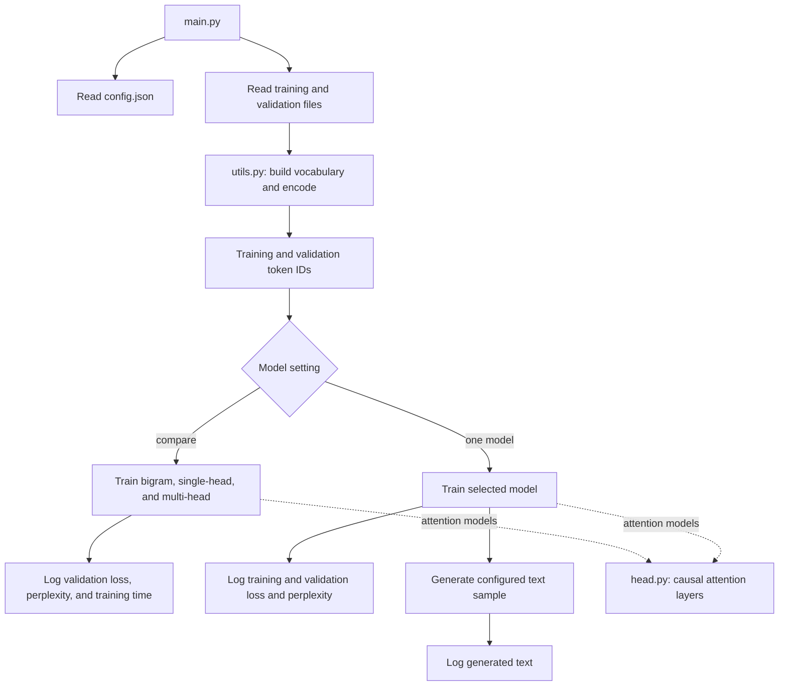

# Character-Level Language Models

A small PyTorch project for learning how language models work. It trains
character-level models on WikiText-103: a bigram model and single-head and
multi-head causal self-attention models. The default configuration compares
all three.

## What the program does

1. Reads the locally downloaded WikiText-103 training and validation files.
2. Lowercases the text and removes characters outside the vocabulary defined
   in `utils.py`.
3. Builds a character vocabulary from the training split and encodes the
   corpus as compact token IDs.
4. Trains either the selected model or all three models when `model` is set to
   `compare`.
5. Logs training and validation loss and character-level perplexity during
   training. Comparison mode also logs a validation-metric summary for all
   three models; single-model mode generates and logs a text sample afterward.

The test split is included in `data/` but is not currently loaded by the
program.

## Program flow



## Project files

```text
main.py               Load settings and data, then train, compare, or generate
model.py              Bigram, single-head, and multi-head model classes
head.py               Single and multi-head causal self-attention layers
utils.py              Text encoding, batches, loss estimation, and training
config.json           Model selection and training settings
requirements.txt      Runtime dependencies
requirements-dev.txt  Test dependencies
data/                 WikiText-103 train, validation, and test splits
```

## Requirements and setup

Python 3.9 or later, NumPy, and PyTorch are required. From the project
directory, create and activate a virtual environment, then install the runtime
dependencies:

```powershell
python -m venv .venv
.\.venv\Scripts\Activate.ps1
python -m pip install -r requirements.txt
```

Run the program from the project directory after activating the environment:

```powershell
python main.py
```

### Downloading the dataset

The WikiText-103 token files are not included in this repository. Download the
archive from the [WikiText-103 dataset page](https://developer.ibm.com/exchanges/data/all/wikitext-103/)
or its [direct archive link](https://dax-assets-dev.s3.us-south.cloud-object-storage.appdomain.cloud/dax-wikitext-103/1.0.0/wikitext-103.tar.gz).
Extract it and place `wiki.train.tokens` and `wiki.valid.tokens` directly in
the project's `data/` directory. The program expects these paths:
`data/wiki.train.tokens` and `data/wiki.valid.tokens`. The test file is not
currently used. Token files are gitignored because the training split is
large; each user downloads the data locally. Dataset license details are in
`data/LICENSE.txt`.

### Running the tests

Install the development dependencies and run the test suite:

```powershell
python -m pip install -r requirements-dev.txt
python -m pytest -q
```

Tests use small temporary text files and synthetic token streams; they do not
train on the full WikiText corpus. The CUDA integration check is skipped when
CUDA is unavailable.

With `device` set to `auto`, the script selects CUDA when available and
otherwise uses the CPU. You can also explicitly select `cpu` or `cuda`.
Training can take a while, especially on CPU. Timestamped progress messages,
loss values, device selection, and generated text are logged to the terminal.

### Running on an NVIDIA GPU

PyTorch must be installed with a CUDA-enabled build, and the NVIDIA driver
must support that build. The `torch` entry in `requirements.txt` declares the
dependency, but does not guarantee that the installed build can use CUDA.
Use the official [PyTorch installation selector](https://pytorch.org/get-started/locally/)
to choose the Windows, pip, and CUDA options appropriate for the machine.
Activate the project's virtual environment before installing.

Check what the active Python environment can see:

```powershell
python -c "import torch; print('PyTorch:', torch.__version__); print('CUDA build:', torch.version.cuda); print('CUDA available:', torch.cuda.is_available()); print('GPU:', torch.cuda.get_device_name(0) if torch.cuda.is_available() else 'not detected')"
```

With `"device": "auto"`, training uses CUDA if `torch.cuda.is_available()`
returns `True`; otherwise it logs that it is using the CPU. Set
`"device": "cuda"` in `config.json` to require CUDA and stop with an error
instead of silently running on CPU. `main.py` logs the PyTorch version, CUDA
build, and GPU name when one is selected.

## Data preparation

Place the WikiText-103 `wiki.train.tokens` and `wiki.valid.tokens` files in
`data/` as described above. The program uses the existing training and
validation splits; it does not split the training file again. The training
file is read to build the vocabulary and encode the training data. The
validation file is encoded using that same vocabulary.

Data is processed a line at a time and stored as one-byte token IDs to avoid
constructing a large Python list of integers for the training corpus. Batches
are converted to PyTorch `long` tensors when sampled, as required for embedding
lookups.

Text preprocessing lowercases characters and preserves letters, whitespace,
and the punctuation specified by the cleaner in `utils.py`. Other characters,
including digits, are removed.

The dataset description and its Creative Commons Attribution-ShareAlike 3.0
license are included in `data/README.txt` and `data/LICENSE.txt`. The upstream
dataset is [WikiText-103](https://developer.ibm.com/exchanges/data/all/wikitext-103/).

## Configuration

`config.json` controls the training loop:

- `model`: `bigram`, `single_head`, `multi_head`, or `compare` to run all
  three models in sequence.
- `optimizer`: `adam` or `adamw`.
- `device`: `auto`, `cpu`, or `cuda`.
- `seed`: random seed used to initialize the run.
- `train_file` / `validation_file`: corpus filenames inside `data/`.
- `max_new_tokens`: number of characters to generate after training.
- `batch_size`: sequences sampled per training step.
- `block_size`: characters in each input sequence.
- `n_embd`: width of token and position embeddings.
- `n_head`: number of parallel causal attention heads for `multi_head`.
  `n_embd` must be divisible by `n_head`.
- `learning_rate`: selected optimizer's learning rate.
- `max_iters`: number of training steps.
- `eval_interval`: steps between loss reports.
- `eval_iters`: batches averaged for each loss report.

## Models

The `multi_head` model combines character and position embeddings, then
processes them with multiple causal attention heads in parallel. Each head
learns a different query, key, and value projection; their outputs are
concatenated and projected back to the embedding width. The causal mask
prevents a position from looking at future characters.

`SingleHeadLanguageModel` and `BigramLanguageModel` remain in `model.py` as
simpler alternatives. Change the `model` setting in `config.json` to select
one when running the program. Set it to `compare` to train all three with the
same configured training and evaluation settings and log validation loss,
character-level perplexity, and training time for each. Comparison mode does
not generate a text sample; single-model mode does.

## What happens during training

The corpus is treated as a long stream of character IDs. For each training
batch, `get_batch` picks random starting positions and makes two same-sized
sequences: `x` contains characters and `y` contains the next character at each
position. For example, if `x` is `abc`, its targets are `bcd`. The model
produces a score (logit) for every possible next character at each position.
Cross-entropy loss measures how well those scores predict the targets;
backpropagation and the optimizer update the model parameters to reduce that
loss.

Every `eval_interval` training steps, the program samples `eval_iters` batches
from both the training and validation splits and averages their losses. This
is a measurement only: evaluation does not update the model. The program also
logs character-level perplexity, calculated as `exp(loss)`. Validation loss
and perplexity are useful for comparing models on data that was not used for
their parameter updates.

For attention models, `block_size` is both the number of characters in each
training sequence and the maximum context considered during generation.
`n_embd` is the width of each character/position representation. Multi-head
attention divides that width among `n_head` heads, so `n_embd` must be
divisible by `n_head`. The bigram model does not use position embeddings or
attention, so `n_embd` and `n_head` do not affect it.

The repository's `license` file covers the project code. The dataset has its
own license in `data/LICENSE.txt`.
